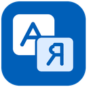

# Dagami Antigravity Language Pack

Языки для Google Antigravity Desktop и IDE: русский, китайский, испанский,
японский, немецкий и французский.

Версия 1.2.0 — нативные сборки для Windows, Linux и macOS.
[Итог правок и рамки](AUDIT_FIXES.md). [Порты и рамки](PORTS.md).

[Релизы](https://github.com/j46871417-ui/Dagami-Antigravity-Language-Pack/releases) ·
[Что сделано](CHANGES_1.2.0.md) · [Как запустить](INSTRUCTIONS.md)

## Готовые сборки

| ОС | CPU | Пакет |
| --- | --- | --- |
| Windows | x64 | ZIP |
| Linux | x64, ARM64 | TAR.GZ |
| macOS 15+ | Intel, Apple Silicon | TAR.GZ |

Python входит в готовые сборки. Для запуска кода нужны Python и Tk.
Пять пакетов прошли сборку и `--verify-bundle` в CI.
GUI и запись в реальную IDE на Linux/macOS пока не проверены.
На macOS правка IDE с подписью или ASAR integrity даёт отказ до записи.
Сама утилита имеет подпись ad hoc, без Developer ID и нотариуса Apple.

## Windows

Распакуйте весь ZIP. Запустите EXE, выберите язык и пути, затем нажмите
«Установить язык». Сначала закройте Antigravity и сохраните свою работу.
Кнопка возврата к English ставит исходные файлы из копии.

В сборке из папки переносите весь пакет, включая `_internal`.
Для смены версии замените весь пакет вручную и снова нажмите «Установить язык».
Новый EXE сам по себе не меняет уже вшитый движок Antigravity.

## Перевод и вид текста

Обычные подписи UI меняются по местным словарям. Код, редактор, терминал и
поля ввода пропускаются.

Кнопка RU/EN у мысли включает перевод в сети. «Авто» включает его для новых
мыслей. По умолчанию этот режим выключен. Текст мысли уходит в сервис Google.
Код, URL и поля ввода из этого пути исключены.

Новый движок делает копию блока и переводит лишь его текстовые узлы.
Списки, таблицы, ссылки, стили и код остаются на своих местах.
Исходный блок не переписан. EN возвращает его с прежними стилями.
Кнопка копии и ссылки в копии вызывают прежние действия.
При смене текста перевод отменяется; поздний ответ не заменяет свежий блок.
Очередь допускает два запроса разом; кеш ограничен.

## Обновления с GitHub

Кнопка «Обновления» открывает версию, итог проверки и текст релиза.
Проверка идёт при запуске и раз в 6 часов; есть флаг её отключения.
Тестовые версии ищутся лишь по вашему выбору.

Для onefile загрузка, установка и перезапуск — лишь по кнопке.
Сборка из папки может лишь скачать файл; весь пакет меняется вручную.
Во время записи языка кнопка установки новой версии недоступна.
Windows EXE проверяет SHA-256 из GitHub API, размер, имя продукта и версию EXE.
План защищён Windows DPAPI для вашего входа.
Помощник — копия текущего EXE. Он ждёт выхода старой копии, сверяет её хеш,
сохраняет старый EXE, ставит новый и при сбое записи делает откат.
Чужой изменённый файл не затирается. Профили и файлы Antigravity обновлятор
не трогает. Итог и путь старой копии хранятся в папке updates.

Хеш — проверка файла по данным GitHub, а не подпись автора.
Токен GitHub не нужен. Проверка TLS включена.
Сеть пробуется напрямую и через ваш системный прокси.
Можно задать DAGAMI_UPDATE_PROXY. Для моста на 127.0.0.1:53200
нужен явный флаг DAGAMI_UPDATE_USE_BRIDGE=1.
Сетевые настройки Windows при этом не меняются.
Для белого списка нужны api.github.com, github.com,
release-assets.githubusercontent.com и при нужде objects.githubusercontent.com.

В папке без прав записи установка не идёт. Для переносной копии
выберите свою папку. Linux/macOS и запуск из исходников умеют проверить
релиз и скачать пакет; ставить его в этом режиме нужно вручную.

## CLI

Нужен Python 3.10+ при запуске исходников. Windows EXE включает Python.

~~~sh
dagami-ag-localizer --list
dagami-ag-localizer --lang ru
dagami-ag-localizer --lang es
dagami-ag-localizer --restore
dagami-ag-localizer --check-update
dagami-ag-localizer --download-update
~~~

При запуске из исходников в Windows есть .cmd, в Linux/macOS — .sh.
В Windows ZIP лежит EXE, папка `_internal` и справка. Для CLI передайте флаги этому EXE.
Файл .cmd нужен лишь при запуске из исходников.
Флаг --update проверяет местные языки; он не ставит новую версию утилиты.
После смены PATH откройте новый терминал.

## Как устроен проект

- [Ядро](dagami_ag_localizer.py): GUI/CLI, поиск путей, выбор языка, ASAR и откат.
- [Сборка JS](dagami_translator_builder.py): словари, правила UI и новый движок.
- [Вид мысли](translations/structured_thoughts.js): копия DOM, очередь, кеш и отмена.
- [GitHub](app_updates.py): версии, сеть, SHA-256, план и замена EXE.
- [Окно версий](update_ui.py): фоновая проверка и явная кнопка установки.
- [Данные](app_info.py): одно имя и номер для CLI, GUI, сборки и архива.
- [Сборка](build_release.py): нативный пакет для своей ОС и CPU.

ASAR читается с вашего ПК, а не заменяется чужим готовым файлом.
Исходная копия хранится рядом. При смене языка за основу берётся эта копия.
Не меняйте её вручную. После обновления самого Antigravity проверьте версию
и новую базовую копию перед повторной записью языка.

Старые модули и Program.cs оставлены для прошлых тестов и истории.
В новые пакеты Program.cs не входит; старый путь сборки .NET отключён.
Старая копия app.asar и старый веб-код в пакеты не входят.
Новый движок меняет файлы той версии Antigravity, что стоит у вас.
EXE включает Python и Tk: ставить их отдельно в Windows не нужно.

## Сборка и тесты

~~~sh
python -m pip install -r requirements.txt
python build_release.py
python -m unittest discover -s tests -t .
node tests/test_markdown_shield.mjs
node tests/test_queue_and_splitting.mjs
node tests/test_translation_governance.mjs
node tests/test_structured_thoughts.cjs
~~~

Последний тест требует Playwright и Chromium. Он работает без сети на
тестовых данных. В CI он идёт до сборки.
Один EXE попадает и в ZIP, и в отдельный файл. Пакеты имеют SHA-256.
Скрипт сборки ничего не публикует.

Проверки выполнены на Windows. Архивы Linux/macOS содержат исходники и
скрипты; запуск на этих ОС ещё не проверен. Работа всех будущих версий
Antigravity не обещана.

## Связь и права

[Чат](https://t.me/+8qU7020rMF84OWNi) ·
[Поддержать](https://pay.cloudtips.ru/p/671fda86)

Код проекта — MIT, см. [лицензию](LICENSE).
Google Antigravity принадлежит Google LLC.
